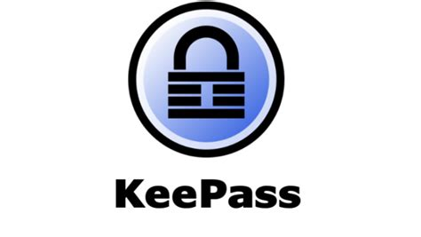
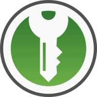

# Managing my passwords with KeePass and OwnCloud

I had been trying to find the perfect setup for managing my passwords for a while, and I think I'm getting close.

<!-- more -->

If you don't really trust online password managers like me, you might also want to manage your passwords offline.

Enters KeePass!

## KeePass / KeePassX / KeePassXC

 

To sum it up, **KeePass** was originally an open-source offline password manager on windows. It basically created its own format for storing your database file of credentials, and you set up a master password to access the database using the software.

It also allows you to generate random passwords.

**KeePassX** was then created as an attempt to have a linux version of it. (Although I think that nowadays both KeePass and KeePassX are actually cross-platform applications).

After a while, a big part of the keepass community decided to fork KeePassX and created **KeePassXC** (for slow development reasons on the former, apparently).

KeePassXC also has a way nicer UI / UX than it's predecessor in my opinion. Furthermore, it runs on Mac OS / Linux / Windows.

The concept is the same : you have a local encrypted database file containing all your passwords and can access them using a master password.

I've been using KeePassXC for a while now on my macbook, and I have to admit that I can't complain about anything. It's a great application!

## What about smartphones?

Well, I personally own an Android phone (although I'm probably going to switch to iOS soon, but more on that in another post later...)

I am using an application called **KeePass2Android.** There are others, but that's the one I preferred.

It also uses a local file to store your password.

## Keep it in sync

Now, you're probably wondering : how do I keep the 2 databases (computer and phone) in sync?

Well, there are multiple solutions for that : Dropbox, Google Drive, BT Sync (now renamed resilio sync)...

I personally used a private owncloud server that I have an access to, but other options can be more straightforward!

Usually, KeePass applications can have two ways of accessing that data :

- they can support directly your specific cloud storage

- they can read from a local file which means you'll have to have another application in charge of syncing to your cloud

I went with the latter simply because my keepass applications didn't support OwnCloud! In any case, once I installed OwnCloud on mac and android and configured them I never had to open them again so it's not so bad.

## Browser completion

I started looking at browser auto-completion recently and for now I'm using [KeePass Tusk](https://github.com/subdavis/Tusk "KeePass Tusk") (available on Chrome and Firefox).

The big drawback I have with it is that the only way for it to access my database in owncloud is through a publicly available link there, which isn't great. I wish it could either read from the local file on my computer, or connect to owncloud directly.

In practice, it means I wouldn't need to expose the database through an URL. That database is password protected and good luck finding the link, but still, it's not ideal in my opinion!

## Conclusion

Obviously this is my personal setup and it's not for everyone. Each of the tools I mentioned have some alternatives too! KeePass isn't the only player in the game (I heard [pass](https://www.passwordstore.org/) is very good too).

However, I hope it proves that you can really store and access your passwords the way you want! You shouldn't use a tool you don't feel comfortable keeping your credentials.
