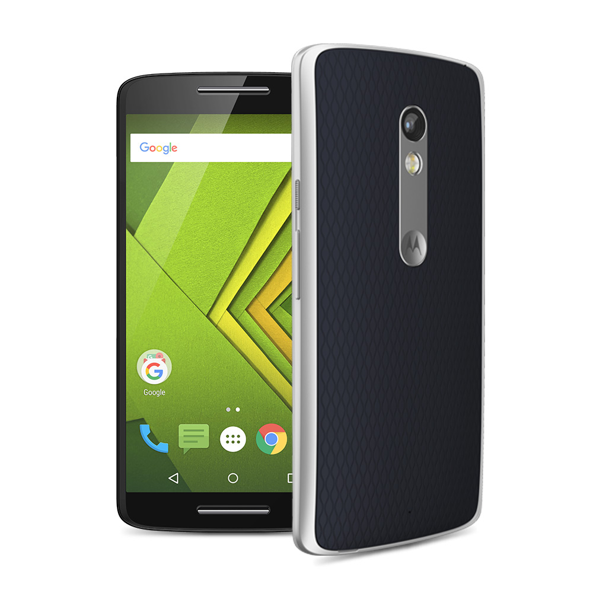

# I gave up on Android

I had been using Google's mobile OS for a while, but now it's time to say goodbye...

<!-- more -->

This is the story of why I used Android phones, and why I recently switched to iOS. Therefore, I will talk about both Google and Apple since they're the only two real options on this market.

Let's be clear, I always enjoyed Apple products. However, they tend to be a bit pricey.

While I'm okay in buying an expensive computer as I tend to use them for work related stuff, I find it harder to justify spending around €1,000 for a phone. Therefore, I used to mostly look at mid-range android phones (from €300 to €500). In theory, they fit my need of a lower price phone that does everything I need well enough. I always found iOS to be the better operating system, however android was good enough for me as I could save €500!

But I give up on that now for multiple reasons... Please note that some of these reasons might not be an issue on very expensive android phones, but as I said, I honestly prefer iOS for a similar price.

Anyway, let's go into details on why I gave up on Android!

## Google

Oh, Google... There would be so much to say about this company, but I'm going to be brief. Let's just say that over the years I've tend to lose respect for Google more and more.

This is of course mostly related to the privacy issues. Overall, I feel that I really can't trust this company with my data anymore.

Just have a look over this [wikipedia page](https://en.wikipedia.org/wiki/Privacy_concerns_regarding_Google).

Apple tends to respect more its users so I'm glad to join them on that aspect.

I had a look many times at setting up somehow a Googleless Android, but roms are complicated to install, and not always well maintained depending on your device. Also, some android apps and services may still requires you sign-in using a Google account.

## A dying phone

This is my (now former) android phone: A Motorola Moto X Play.

When I bought it two and a half years ago, it was at a decent price, had some of the best online reviews, and was powerful enough for my needs.

I was really happy with it... for about a year and a half. Then everything progressively started to fall apart!

First and foremost, my micro USB port was getting worse and worse. I had to do this trick I found online of using a sharp stick to replace it properly almost every week so that I can somehow manage to charge my phone. In the last few months, it sometimes took me several minutes for me to manage to find the sweet spot where my phone would accept to charge. And then I had to make sure my phone wouldn't move at all, else I would start over again. And some micro usb cables simply wouldn't work at all anymore! So I sometimes couldn't charge my phone in my friends' house. Extremely annoying!

Speaking of battery, my phone would also randomly shut down saying the battery level was at zero even though I had plenty left. It would then be able to turn back on, so there definitely was some battery left. This would mostly happen when using resource heavy applications (the camera most often triggered it, but Google Maps would do it too sometimes). I like traveling a lot so having my phone shutdown when I'm trying to take pictures in the middle of Kyoto or Seoul was very painful.

Another issue I had was that my flashlight completely stopped working 4 months ago, after an OS update. Thanks for the update Google!

One other time, around 6 months ago, I tried to migrate data from the internal memory towards the micro SD card. I used the system tool that is part of Android for that, so it should be all ok, right? Haha, well no. Actually it failed somehow, but more importantly it managed to make the android back button stop working completely. If you have an android phone, I challenge you to try using yours for an hour without that button. After hours of attempts and online research, I managed to fix it by installing a completely different Launcher... What the hell, Android!

## Alternatives?

So after all this, I gave up. Sorry Google! It's not me, it's definitely you! You and your lack of respect for my online privacy. You and your OS that seems to mostly work but that gave me so many headaches!

Ultimately, I started to look at alternatives, and let's be honest there is a big lack of alternatives!

There is only one real one in Apple's iOS. I bought an iPhone XR and I like it so far. However, I wish there was some true open source alternative. Basically, what Linux is for computers. Hopefully this will happen some day, but I doubt it...
